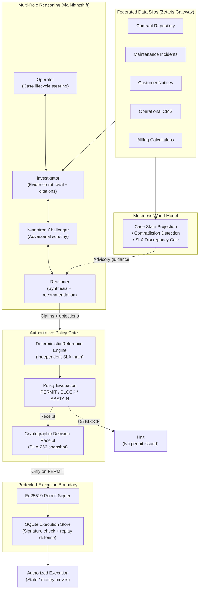

<p align="center">
  
</p>

<h1 align="center">CEREV</h1>

<p align="center">
  <strong>Pre-Execution Evidence Integrity Layer for Autonomous Agents</strong>
</p>

<p align="center">
  
  
  
  
  
  
  
</p>

<p align="center">
  <em>"Agents are great at deciding what to do, and terrible at proving their evidence hasn't expired or been contradicted.<br/>CEREV is the pre-execution integrity gate that forces an agent to prove its action across federated silos before money or state moves."</em>
</p>

---

## The Problem

Autonomous agents move fast. They retrieve information, reason over it, and then act — issuing credits, mutating databases, triggering payments. The problem is that the gap between *"the model decided this"* and *"this is actually correct and safe to execute"* is enormous.

- Evidence goes stale. A record retrieved 10 minutes ago may no longer be accurate.
- Data silos contradict each other. The billing system says one thing; the contract repository says another.
- LLM consensus is not authorization. Four agents agreeing does not make an action safe to execute.
- Replay attacks and double-execution are real. Without a hard execution boundary, the same action can fire twice.

CEREV sits between the agent and the action. It does not decide what to do — it decides whether the evidence is strong enough to allow it.

---

## How It Works

CEREV runs a structured, five-stage process before any consequential action executes:

```
1. Federated Evidence Retrieval
   ↓ (gather records from all relevant data silos)
2. Multi-Role Collaborative Reasoning
   ↓ (investigate, challenge, and synthesize the evidence)
3. Deterministic Policy Evaluation
   ↓ (independent math — no LLM involvement)
4. Cryptographic Execution Permit
   ↓ (issued only on PERMIT; bound to exact action fingerprint)
5. Protected Execution Boundary
   ↓ (verifies permit, prevents replay, executes once)
```

### The non-negotiable rule

**Only the deterministic policy engine can authorize an action.** Agents investigate and recommend. They never authorize. No model confidence score, no LLM consensus, no sponsor model output can issue a PERMIT or override a BLOCK.

---

## Architecture



---

## Worked Example — SLA Credit Dispute

This is the canonical benchmark case CEREV ships with.

**Scenario:** An autonomous billing agent proposes a **$48.00** SLA credit for Client A following March 2024 outages.

**What CEREV does:**

| Stage | Finding |
|---|---|
| **Zetaris retrieval** | 18 records pulled across 5 silos: Contract V4, 4 maintenance incidents (423 total outage minutes), 3 customer notice logs, CMS root causes, billing records |
| **Meterless World Model** | Projects case state; calculates authoritative credit of **$192.00**; flags **-$144.00** discrepancy against proposed $48.00 |
| **Nemotron Challenger** | Adversarially audits the 3 customer notice windows (41h, 37h, 34h) against Contract V4's 48-hour prior written notice requirement — all three are non-qualifying |
| **Deterministic engine** | Availability = 99.0524% (threshold 99.5%); 4 shortfall intervals confirmed; calculated credit = **$192.00** |
| **Policy gate** | Proposed $48.00 ≠ calculated $192.00 → **BLOCK** |
| **Execution boundary** | No Ed25519 permit issued. Money does not move. |

**Synthetic PERMIT path:** When a fully evidenced case is submitted (correct 48h notice, proposed credit matches calculated), CEREV issues a cryptographic permit, executes exactly once, and rejects all subsequent replay attempts.

---

## Sponsor Integrations

| Technology | Role | Status |
|---|---|---|
| **Zetaris** | Federated evidence retrieval across 5 heterogeneous silos | ✅ Live-verified (18 records, Gateway SQL Proxy) |
| **Meterless Engine** | World Model — case projection, contradiction tracking, SLA discrepancy | ✅ Integrated + tested |
| **Meterless Nightshift** | OpenAI-compatible LLM provider abstraction with request tracing | ✅ Integrated + tested |
| **NVIDIA Nemotron** | Adversarial Challenger role (`nvidia/llama-3.1-nemotron-70b-instruct` via Nightshift) | ✅ Integrated + tested |

---

## Getting Started

**Requirements:** Python 3.12+

```sh
# 1. Clone and set up the environment
git clone https://github.com/danielamodu/cerev
cd cerev
python -m venv .venv

# 2. Activate the virtual environment
.venv\Scripts\Activate.ps1        # Windows
# source .venv/bin/activate        # macOS / Linux

# 3. Install with dev dependencies
pip install -e ".[dev]"
```

### Run the demo

```sh
cerev-demo          # interactive terminal walkthrough
cerev-demo --json   # structured JSON output
```

The demo walks through both scenarios: the canonical BLOCK case and the synthetic PERMIT case with replay rejection.

### Run the tests

```sh
pytest -q
```

413+ tests covering unit, integration, adversarial boundary, and replay scenarios. All passing.

### Live Zetaris evidence

Add your Zetaris credentials to `.env` (see `.env.example`) and set:

```sh
CEREV_EVIDENCE_MODE=zetaris
```

---

## Project Layout

```
cerev/
├── reference.py          # Deterministic SLA reference engine (the sole authority)
├── evidence.py           # Evidence model, provenance, and packages
├── source_adapters.py    # Five independent local source adapters
├── zetaris.py            # Zetaris Gateway SQL proxy + live source adapters
├── meterless.py          # Meterless World Model — case projection and discrepancy tracking
├── nightshift.py         # Nightshift LLM provider client with request attribution
├── agent_roles.py        # LLM role adapters: Investigator, Challenger, Operator, Reasoner
├── coordinator.py        # Multi-role coordination loop (fail-closed outcomes)
├── orchestration.py      # Role contracts, citation binding, case context, state transitions
├── policy.py             # PERMIT / BLOCK / ABSTAIN policy evaluation
├── permit.py             # Ed25519 execution permit generation
├── adapter.py            # Protected execution boundary (nonce, signature, replay defence)
├── receipt.py            # Cryptographic decision receipts
├── replay.py             # Deterministic replay from retained snapshots
├── memory.py             # Typed append-only shared reasoning memory
├── durable_runtime.py    # SQLite durable workflow, journaling, hash-linked events
├── evidence_provider.py  # Scoped read-only evidence provider
└── demo.py               # CLI demo entry point

fixture/                  # Canonical JSON fixtures (billing, contract, incidents, notices)
docs/                     # Architectural notes per phase
tests/                    # Full test suite (unit, integration, adversarial)
```

---

## Core Design Invariants

These invariants are never compromised:

1. **Agents investigate. They never authorize.** The deterministic engine holds sole authority over PERMIT/BLOCK/ABSTAIN.
2. **Fail-closed by default.** Missing evidence, provider failure, unproven assumptions — all produce BLOCK or ABSTAIN.
3. **Every proposal revision must be re-verified.** A new evidence package is required; there is no shortcut revision path.
4. **Execution permits are cryptographically bound.** Permits are signed with ephemeral Ed25519 keys, linked to a specific decision receipt hash and exact action fingerprint.
5. **No replay.** Nonces are reserved atomically before execution; duplicate nonces are rejected at the boundary.
6. **Agents never hold signing keys.** The execution boundary is isolated; agent roles have no access to permit signing material.

---

## Documentation

- [`docs/DEMO_SCRIPT.md`](docs/DEMO_SCRIPT.md) — Hackathon demo walkthrough script
- [`docs/zetaris-gateway-proxy.md`](docs/zetaris-gateway-proxy.md) — Zetaris Gateway integration
- [`docs/nightshift-provider.md`](docs/nightshift-provider.md) — Nightshift provider and attribution
- [`docs/central-reasoning-coordinator.md`](docs/central-reasoning-coordinator.md) — Coordinator loop and role contracts
- [`docs/durable-orchestration-runtime.md`](docs/durable-orchestration-runtime.md) — SQLite durable orchestration
- [`docs/protected-execution.md`](docs/protected-execution.md) — Ed25519 permits and execution boundary
- [`FINAL_PRE_SUBMISSION_VERIFICATION.md`](FINAL_PRE_SUBMISSION_VERIFICATION.md) — Pre-submission audit report

---

*Built for the Open Agent Hackathon 2026 — Track 3: Reasoning Architecture.*
