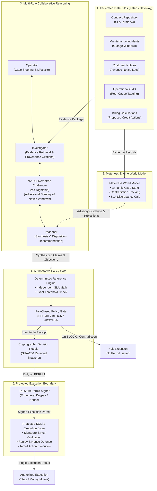

# CEREV — Pre-Execution Evidence Integrity Layer for Autonomous Agents

**Open Agent Hackathon 2026 — Track 3: Reasoning Architecture**

> *"Agents are great at deciding what to do, and terrible at proving their evidence hasn't expired or been contradicted. CEREV is the pre-execution integrity gate that forces an agent to prove its action across federated silos before money or state moves."*

---

## Architectural Thesis & Core Invariants

Autonomous agents frequently move directly from probabilistic LLM outputs to external consequential actions (e.g. issuing financial credits, executing database mutations, or modifying infrastructure state). In multi-agent frameworks, consensus between LLMs or high model confidence is often falsely equated with authorization.

**CEREV establishes a strict, non-negotiable pre-execution integrity boundary:**
1. **Agents Investigate, Reason, and Challenge:** Four specialized roles (Operator, Investigator, Challenger, Reasoner) collaborate to retrieve federated evidence, detect contradictions, and synthesize findings.
2. **Deterministic Engine is the Sole Authority:** Final action approval (`PERMIT`, `BLOCK`, `ABSTAIN`) is calculated strictly by a deterministic policy and reference engine. No LLM or sponsor model can ever authorize an action or override a `BLOCK`.
3. **Cryptographic Execution Permits:** Legitimate actions that pass deterministic verification receive short-lived, tamper-evident Ed25519 permits bound to canonical decision receipt hashes and exact action fingerprints.
4. **Protected Execution Boundary:** Downstream targets execute only when presented with a valid Ed25519 permit. Replay attacks and duplicate nonces are rejected idempotently by an isolated execution store.
5. **Fail-Closed by Design:** Missing evidence, unproven assumptions, expired credentials, or provider failures deterministically fail closed.

---

## Architecture Diagram



---

## Sponsor Technologies & Integration Matrix

| Sponsor Technology | Role in CEREV | Implementation & Verification Status |
| :--- | :--- | :--- |
| **Zetaris** | Federated evidence retrieval across 5 heterogeneous data silos | **LIVE-VERIFIED** (Gateway SQL Proxy connected & verified across 5 source adapters with 18 canonical records) |
| **Meterless Engine** | World Model case projection, contradiction detection, and SLA discrepancy tracking | **INTEGRATED & TESTED** (`SimulatedMeterlessWorldModel` & `LiveMeterlessWorldModelClient`, unit tests, workflow tests) |
| **NVIDIA Nemotron** | Specialized adversarial Challenger model (`nvidia/llama-3.1-nemotron-70b-instruct`) via Nightshift | **INTEGRATED & TESTED** (`NemotronChallenger` with attribution tracking, 5 scenarios, mock-backed tests) |
| **Meterless Nightshift** | Provider abstraction for OpenAI-compatible LLM chat completions | **INTEGRATED & TESTED** (Bearer auth, serving-model attribution, request tracing, mock test suite) |
| **Four LLM Roles** | Operator, Investigator, Challenger, Reasoner multi-role orchestration | **INTEGRATED & TESTED** (All 4 roles invoked and validated in production `ReasoningCoordinator` loop) |
| **Deterministic Reference Engine** | Authoritative SLA math & threshold verification | **AUTHORITATIVE POLICY GATE** (Sole source of `PERMIT`/`BLOCK` decisions; agents have 0 authorization authority) |
| **Ed25519 Execution Permits** | Cryptographic authorization token generation | **CRYPTOGRAPHIC BOUNDARY** (Permits signed with ephemeral keys; verified against decision receipt hashes) |
| **Protected SQLite Store** | Execution boundary, nonce reservation, and replay prevention | **ISOLATED EXECUTION** (Rejects tampered payloads, expired permits, forged signatures, and duplicate replays) |

---

## Quickstart & Interactive Demonstration

### 1. Installation & Environment

Requirements: Python 3.12 or newer.

```sh
# Clone repository and create virtual environment
python -m venv .venv
# Activate virtual environment
.venv\Scripts\Activate.ps1   # Windows PowerShell
# source .venv/bin/activate    # macOS/Linux

# Install package with development dependencies
python -m pip install --upgrade pip
python -m pip install -e ".[dev]"
```

### 2. Run Comprehensive Test Suite

Run all 413+ unit, workflow, and adversarial tests:

```sh
pytest -q
```

### 3. Run the Demonstration CLI

Experience the end-to-end evidence integrity walkthrough (Canonical BLOCK & Synthetic PERMIT):

```sh
# Terminal interactive walkthrough
cerev-demo
# or equivalently
python -m cerev.demo

# Structured machine-readable JSON output
cerev-demo --json
```

For live Zetaris evidence retrieval, set `CEREV_EVIDENCE_MODE=zetaris` along with `ZETARIS_API_KEY` and `ZETARIS_BASE_URL` in `.env`.

---

## Canonical SLA Incident Benchmark

CEREV is benchmarked against a real-world enterprise SLA scenario:
- **Case:** Client A proposes a **$48.00** (480,000 cents) SLA credit for March 2024 outages.
- **Federated Evidence Retrieval:** Gathers 18 records across 5 distinct silos (Contract V4, 4 Maintenance Incidents totaling 423 outage minutes, 3 Customer Notice logs, Operational CMS root causes, Billing calculations).
- **Meterless World Model:** Synthesizes the case state, surfaces an authoritative calculated credit of **$192.00**, and tracks a **-$144.00** discrepancy against the proposed action.
- **NVIDIA Nemotron Scrutiny:** Adversarially audits maintenance notices and discovers that notice windows (41h, 37h, 34h) violate the strict 48-hour prior written notice clause in Contract V4.
- **Deterministic Policy Disposition:** availability is 99.0524% (< 99.5% threshold), yielding 4 shortfall intervals and an authoritative calculated credit of $192.00. Because proposed ($48.00) does not match calculated ($192.00), the policy gate produces a deterministic **BLOCK**.
- **Cryptographic Enforcement:** No Ed25519 execution permit is issued. The protected execution boundary ensures money does not move.
- **Synthetic Qualifying Scenario:** Demonstrates that when qualifying 48h notice exists and the proposed credit matches $192.00 exactly, a **PERMIT** is issued, an Ed25519 permit is cryptographically signed, the first execution succeeds, and subsequent replay attacks are rejected.

---

## Module Map

- `cerev/reference.py`: deterministic Contract V4 SLA reference calculation.
- `cerev/evidence.py`: source records, timestamp semantics, provenance, and evidence packages.
- `cerev/source_adapters.py`: independent local source stores, retrieval metadata, structured failures, and fail-closed collection.
- `cerev/zetaris.py`: separate direct REST and Gateway proxy transports plus five canonical logical source adapters; adapters validate transport envelopes, inspect shared relation inventories, and reconstruct their assigned categories.
- `cerev/meterless.py`: Meterless Engine World Model protocol, dynamic case projection, SLA discrepancy tracking, and advisory guidance.
- `cerev/nightshift.py`: Meterless Nightshift provider client, model-invocation trace, and opt-in live smoke test.
- `cerev/agent_roles.py`: LLM-powered role adapters (Investigator, Challenger, Operator, Reasoner, and NemotronChallenger) with per-request model attribution.
- `cerev/orchestration.py`: role contracts, provenance-bound citations, evolving case context, proposal bindings, and bounded state transitions.
- `cerev/evidence_provider.py`: scoped, bounded read-only provider protocol, explicit SAMPLE/Zetaris mode selection, and no-fallback provider wiring.
- `cerev/coordinator.py`: multi-role coordination, deterministic read-only tools, verification feedback loop, fail-closed outcomes, and hash-linked run trace.
- `cerev/durable_runtime.py`: SQLite workflow, operation, checkpoint, append-only event, and shared-memory persistence integrated with coordinator.
- `cerev/memory.py`: typed case-memory records, relationships, bounded queries, summaries, and role-scoped read/write capabilities.
- `cerev/conflicts.py`: deterministic cross-source findings linked to evidence.
- `cerev/policy.py`: independent `PERMIT`/`BLOCK`/`ABSTAIN` policy evaluation.
- `cerev/receipt.py`: canonical immutable decision receipts and local JSON storage.
- `cerev/replay.py`: replay from retained evidence snapshots and result comparison.
- `cerev/permit.py`: short-lived Ed25519 permits bound to a verified decision and exact action.
- `cerev/adapter.py`: permit verification, atomic SQLite nonce reservation, execution state, and simulated target.
- `cerev/demo.py`: unified demonstration CLI showcasing sponsor execution paths, Canonical BLOCK, Synthetic PERMIT, and replay rejection.

---

## Architectural History & Prior Phases

The repository completed foundational and integration phases:
- **Phases 0–8:** Repository foundation, canonical fixture, deterministic reference engine, evidence architecture, conflict detection, decision receipts/replay, cryptographic Ed25519 execution permits, and protected execution boundary.
- **Phase 9:** Immutable role contracts and central reasoning coordinator with bounded cycles and revision lineage.
- **Phase 10:** Single-host SQLite durable runtime, operation journaling, hash-linked events, and ambiguity-aware recovery.
- **Phase 11:** Typed, append-only shared reasoning memory integrated with coordinator checkpoints.
- **Phase 12:** Zetaris Gateway SQL proxy transport and five logical source adapters with 18 canonical records live-verified.
- **Phase 13.1:** Meterless Nightshift provider abstraction with request tracing and model attribution.
- **Phase 13.2:** LLM-powered role adapters wired into the executable coordinator loop.
- **Integrated Sprint:** Meterless Engine World Model integration, NVIDIA Nemotron Challenger via Nightshift, end-to-end multi-sponsor execution path, adversarial boundary defenses, and CLI demo.

See documentation in `docs/` for detailed architectural notes on each phase:
- [docs/DEMO_SCRIPT.md](docs/DEMO_SCRIPT.md): Hackathon video demonstration script (1–4 minutes).
- [docs/zetaris-gateway-proxy.md](docs/zetaris-gateway-proxy.md): Zetaris Gateway proxy contract and verification.
- [docs/nightshift-provider.md](docs/nightshift-provider.md): Nightshift provider and model attribution.
- [docs/central-reasoning-coordinator.md](docs/central-reasoning-coordinator.md): Coordinator loop and role contracts.
- [docs/durable-orchestration-runtime.md](docs/durable-orchestration-runtime.md): Durable SQLite orchestration and recovery.
- [docs/protected-execution.md](docs/protected-execution.md): Ed25519 permits and protected execution boundary.
