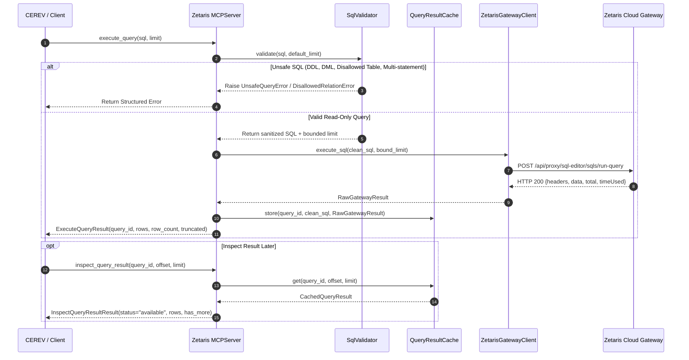

# Architecture & Data Flow Specification

## 1. Executive Architectural Overview

The Zetaris MCP integration provides an enterprise data-access bridge between autonomous agent architectures and the Zetaris Cloud Data Fabric. The design strictly isolates generic MCP data-access primitives from the domain-specific verification rules of the CEREV pre-execution evidence-integrity layer.

```mermaid
flowchart TD
    subgraph Host["Agent / CEREV Host Environment"]
        CEREV_Engine["CEREV Evidence Integrity Engine\n(Deterministic Verifier, Conflict Analysis, Policy Gate)"]
        CEREV_Adapters["ZetarisMcpSourceAdapter (5 Logical Sources)\n(Category Spec, Schema Verifier, Digest Validator)"]
        InProcessClient["InProcessMcpClient / MCP Stdio Client"]
    end

    subgraph MCP_Server["Zetaris MCP Server (zetaris_mcp)"]
        MCPServer["MCPServer (Python MCP SDK 2.x)\nTools: list_datasets, describe_dataset,\nexecute_query, inspect_query_result"]
        Validator["SqlValidator (Firewall)\n- Read-only AST validation\n- DDL/DML/Multi-statement rejection\n- Allowlist & Limit Enforcer"]
        ResultCache["QueryResultCache\n- Thread-safe LRU\n- TTL Expiration\n- Pagination & Inspection"]
        GatewayClient["ZetarisGatewayClient\n- Bounded response reader\n- Secret redactor\n- HTTPS/TLS Engine"]
    end

    subgraph Zetaris_Cloud["Zetaris Cloud Data Fabric"]
        UIProxy["Gateway SQL Proxy\n/api/proxy/sql-editor/sqls/run-query"]
        SparkEngine["Zetaris Lightning / Spark SQL Engine"]
        Storage["Federated Catalogs & Virtual Relations\n(PostgreSQL, Object Storage, Delta/Parquet)"]
    end

    CEREV_Engine --> CEREV_Adapters
    CEREV_Adapters --> InProcessClient
    InProcessClient <-->|MCP Protocol (stdio or direct)| MCPServer
    MCPServer --> Validator
    Validator --> GatewayClient
    GatewayClient -->|HTTPS JSON-RPC POST| UIProxy
    UIProxy --> SparkEngine
    SparkEngine --> Storage
    GatewayClient --> ResultCache
    MCPServer --> ResultCache
```

---

## 2. Dual-Layer Decoupling

### Layer A: Standalone Reusable Zetaris MCP Server (`zetaris_mcp`)
- **Independence**: The MCP server package is completely decoupled from CEREV. It contains no references to CEREV, no SLA formulas, no evidence schemas, and no business logic.
- **Protocol**: Implements the Model Context Protocol (MCP) using the official `mcp>=1.3.0` Python SDK.
- **Transports**: Standard input/output (`stdio`) for process isolation and sub-process invocation by agent orchestrators; also exposes in-process programmatic invocation via `server.call_tool(...)` for zero-overhead in-memory host embedding.
- **Data Access Boundary**: Exposes four generic data discovery and query tools:
  1. `list_datasets`: Enumerate available tables and catalogs adhering to allowlists.
  2. `describe_dataset`: Return column definitions, types, and relation metadata.
  3. `execute_query`: Validate and run approved read-only SQL queries with automatic limit enforcement.
  4. `inspect_query_result`: Inspect previously executed results with offset-based pagination from an LRU cache without re-executing queries.

### Layer B: CEREV Evidence Integration Layer (`zetaris_mcp.cerev`)
- **Adapter Contract**: Implements the existing CEREV `SourceAdapter` protocol, producing standard `SourceRetrieval` objects containing `SourceRecord` entries.
- **Translation**: Translates CEREV's 5 logical evidence sources into bounded read-only SQL queries over Zetaris relations.
- **Strict Envelope Verification**: Decodes Zetaris transport envelopes, enforces SHA-256 payload digests, verifies expected record category counts, and reconstructs canonical evidence representations.
- **Deterministic Evaluation**: Produces standard `EvidenceRecord` items that feed directly into CEREV's conflict detection, reference engine calculation, policy evaluation, and receipt generation.

---

## 3. Query Execution Lifecycle & Data Flow



---

## 4. Component Details

### 4.1 SQL Validator & Firewall (`zetaris_mcp.validator`)
The SQL firewall performs multi-stage defensive validation:
1. **Comment Elimination & Rejection**: Disallows SQL line comments (`--`) and block comments (`/* ... */`). Strips benign whitespace.
2. **Statement Termination**: Enforces single-statement execution by rejecting unquoted semicolons (`_SEMICOLON_SPLIT_PATTERN`).
3. **Keyword Boundary Check**: Rejects any queries starting with non-query verbs (`INSERT`, `UPDATE`, `DELETE`, `DROP`, `ALTER`, `CREATE`, `TRUNCATE`, `GRANT`, `REVOKE`, `SET`, `EXEC`, etc.). Only approved read operations (`SELECT`, `SHOW`, `DESCRIBE`, `EXPLAIN`, `WITH`) are permitted.
4. **AST Table Extraction**: Extracts all referenced table and relation names from `FROM` and `JOIN` clauses using comprehensive regex parsers (`_FROM_JOIN_PATTERN`).
5. **Allowlist Enforcement**: Checks every extracted table against the configured `allowed_relations` set. Any reference to unapproved catalogs or system relations is immediately rejected.
6. **Limit Injection**: If the query omits a `LIMIT` clause, the validator injects the configured default limit. If a `LIMIT` is specified, it clamps the limit to the configured maximum row ceiling (`ZETARIS_MAX_ROWS`).

### 4.2 In-Memory Query Result Cache (`zetaris_mcp.cache`)
Because the Zetaris Gateway UI proxy is stateless and does not retain query execution handles or server-side cursors:
- Results from `execute_query` are retained in an in-memory, thread-safe LRU cache.
- Each entry tracks:
  - `query_id`: Cryptographically strong UUID4 identifier.
  - `sql`: The executed statement.
  - `rows`: Full set of returned row vectors.
  - `headers`: Column names.
  - `row_count`: Returned record count.
  - `total`: Total matching count from gateway.
  - `time_used_ms`: Remote execution duration.
  - `created_at`: Epoch timestamp.
  - `ttl_seconds`: Configured time-to-live (default: 300 seconds).
- The cache supports bounded pagination via `get(query_id, offset, limit)`.
- Explicit status flags differentiate between `"available"`, `"expired"`, and `"unavailable"`.

### 4.3 Gateway HTTP Transport Client (`zetaris_mcp.client`)
- **Protocol**: HTTP/1.1 POST over TLS 1.3 to `/api/proxy/sql-editor/sqls/run-query`.
- **Authentication**: `Authorization: Bearer <API_KEY>`, `X-Org-ID: <ORG_ID>`, `X-Request-ID: <UUID>`.
- **Payload Streaming**: Streams response chunks with an explicit byte ceiling (`max_response_bytes`, default 1 MB). If the upstream payload exceeds the ceiling, execution aborts with `ResourceLimitError` before loading the payload into memory.
- **Strict JSON Parsing**: Enforces duplicate key rejection via `object_pairs_hook` to prevent JSON parameter-tampering or parser ambiguity.
- **Credential Masking**: Any network or HTTP exception is sanitized through `sanitize_message(...)`, guaranteeing that bearer tokens and API keys are never leaked into error messages or logs.

---

## 5. Bounded Resource Management

| Boundary | Enforcement Point | Default Value | Configurable Range |
|---|---|---|---|
| Query Timeout | HTTP Client & Gateway | 30.0 s | 1.0 s - 300.0 s |
| Max Rows per Query | SQL Validator & Clamper | 100 rows | 1 - 10,000 rows |
| Max Response Bytes | HTTP Stream Reader | 1 MB (1,048,576 B) | 1 KB - 50 MB |
| Cache Capacity | LRU Query Result Cache | 50 queries | 1 - 1,000 entries |
| Cache TTL | LRU Query Result Cache | 300 s (5 min) | 10 s - 86,400 s |
